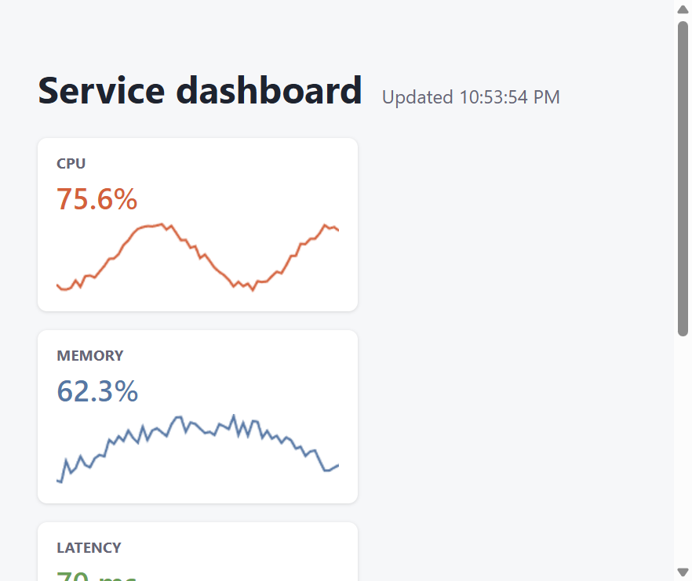

# Dashboard example

A React service dashboard that polls the backend every five seconds. It shows three metric
sparklines drawn on `<canvas>`, latency percentiles and the health of four upstream services.

It shows **async work on the server** (parallel fan-out with promises, CPU-bound work on the
thread pool, server timeouts), **richer schemas** (enums, bounded integers, objects, maps) and
**inline alias files for npm and browser libraries** (React hooks, Canvas 2D, `Intl`). The page
also uses **a build-time React macro**, **`the` in place of generics** and **a mount entry point**.



## Run it

```sh
npm install                  # once, at the repository root
npm run serve:dashboard      # terminal 1: build + tsc + JSON-RPC server on :8080
npm run dev:dashboard        # terminal 2: Vite on http://localhost:5174 (proxies /rpc)
```

## Files

| File | What it is |
|---|---|
| `api.server.lisp` | backend: three structs, four server functions, synthetic metrics |
| `react-aliases.client.lisp` | `use-state`, `use-effect` with dependency arrays, `use-ref`, ...; carries `import { ... } from "react"` into importers |
| `canvas-aliases.client.lisp` | `canvas-2d`, `begin-path`, `move-to`, `line-to`, `stroke-path`, ... |
| `intl-aliases.client.lisp` | `fmt-percent`, `fmt-ms`, `fmt-clock` over shared `Intl` formatter constants |
| `charts.client.lisp` | `draw-sparkline`, built only from canvas aliases |
| `app.clientx.lisp` | the `Dashboard` and `SeriesCard` components, the polling macro |
| `main.clientx.lisp` | entry point: `createRoot(...).render(<Dashboard />)` |
| `index.html`, `vite.config.js` | the page and the dev server proxy |

## How it works

### Server: never block the loop

Server functions run on the event loop, the same thread that serves every other request. The
example shows the two ways to do slow work without stalling it.

**Waiting (I/O-shaped work) uses promises.** `check-services` probes four upstreams that each
take 30–200 ms. `probe` is a `define-async` function that `await`s a `delay`. `all` (the Lisp
`Promise.all`) runs the four probes concurrently, so the call takes as long as the slowest probe,
not the sum. Meanwhile the loop keeps serving other requests.

```lisp
(define-async probe (service base-latency-ms)
  (let ((latency (+ base-latency-ms (random 40))))
    (await (delay latency))
    (make-service-health :service service :status (cond ((> latency 180) "down") ...) ...)))

(define-server-function check-services ()
    (:returns (array service-health) :timeout-ms 1000)
  (all (list (probe "auth" 30) (probe "billing" 110) (probe "search" 60) (probe "email" 160))))
```

`:timeout-ms 1000` bounds the whole call. If the promise has not settled by then, the client gets
`-32003`.

**Computing (CPU-shaped work) uses `offload`.** `latency-percentiles` sorts up to 10,000
floats. `offload` runs the lambda on a worker thread and returns a promise, which the dispatcher
awaits like any other result:

```lisp
(define-server-function latency-percentiles ((samples (array float 10000)))
    (:returns (object (p50 float) (p90 float) (p99 float) (count fixnum)))
  (offload (lambda ()
             (let ((sorted (sort (copy-seq samples) #'<)))
               (list :p50 (percentile sorted 0.5d0) ... :count (length sorted))))))
```

### Schemas used

| Schema | TypeScript | Where |
|---|---|---|
| `(member "cpu" "memory" "latency")` | `"cpu" \| "memory" \| "latency"` | `get-series` param and `metric-series.name` |
| `(integer 10 120)` | `number` (range checked on the server) | `get-series` optional `points` |
| `(array metric-sample 120)` | `MetricSample[]` (at most 120) | `metric-series.samples` |
| `(array float 10000)` | `number[]` (at most 10,000) | `latency-percentiles` input |
| `(object (p50 float) ...)` | `{ p50: number; ... }` | `latency-percentiles` result, built as a property list |
| `(map float)` | `Record<string, number>` | `latest-values`, built from a hash table |

### Frontend: alias files for libraries

The components never import React or touch the Canvas and `Intl` APIs directly. They use three
[alias files](../../docs/inline-aliases.md), each covering one library.

**React.** `&rest` plus `spread` turns trailing arguments into the dependency array:

```lisp
(export (defun use-effect (fn &rest deps) (useEffect fn (vector (spread deps)))))
;; (use-effect f)         ==>  useEffect(f, [])
;; (use-effect f series)  ==>  useEffect(f, [series])
```

`app.clientx.lisp` imports only from `react-aliases`, yet `build/app.tsx` starts with
`import { useState } from "react"`, ... The alias file *carries* the imports its bodies need.

**Intl.** Formatters are expensive to construct, so `intl-aliases` keeps them as real exported
constants and the aliases refer to them. `(fmt-ms x)` becomes `MILLIS.format(x)`, and importers
automatically get `import { MILLIS } from "./intl-aliases"`. This is the one alias module that is
loaded at runtime, once.

**Canvas.** `stroke-path` has three statements. An alias can, but it then belongs in statement
position, because in an expression it would become an immediately invoked function.

### Frontend: patterns worth copying

* **A hook as a macro.** `every-ms` expands at build time into a `useEffect` that runs the body
  immediately, then on an interval, and clears the timer on unmount:

  ```lisp
  (defmacro every-ms (ms &body body)
    `(use-effect (lambda ()
                   (let* ((:const tick (lambda () ,@body))
                          (:const id (set-interval tick ,ms)))
                     (tick)
                     (lambda () (clear-interval id) :undefined)))))
  ```

* **Typed state without generics.** Cast the initial value and TypeScript infers the rest:
  `(use-state (the (array metric-series) (vector)))` → `useState([] as MetricSeries[])`, and
  `(use-ref (the (or |HTMLCanvasElement| null) nil))` → `useRef(null as HTMLCanvasElement | null)`.
* **Parallel calls with tuple types.** `(promise-all (vector (get-series "cpu") (get-series "memory") ...))`
  inside a `:multi` `let` becomes
  `const [cpu, memory, latency] = await Promise.all([...])`, and each element keeps its own type.
* **Server types on the client.** `(import :from :server :targets ((:type metric-series service-health)))`
  gives the components the interfaces generated from `define-rpc-struct`.
* **Component props.** `(declare ((object (series metric-series)) props))` types a component's
  props, and `(:SeriesCard :key (.. s name) :series s)` renders it.

## Try it with curl

```sh
curl -s localhost:8080/rpc -H 'Content-Type: application/json' \
  -d '{"jsonrpc":"2.0","method":"check-services","params":[],"id":1}'

curl -s localhost:8080/rpc -H 'Content-Type: application/json' \
  -d '{"jsonrpc":"2.0","method":"get-series","params":["disk"],"id":2}'
# {"jsonrpc":"2.0","error":{"code":-32602,"message":"Invalid params","data":"$[0]: expected one of \"cpu\", \"memory\", \"latency\""},"id":2}

curl -s localhost:8080/rpc -H 'Content-Type: application/json' \
  -d '{"jsonrpc":"2.0","method":"latency-percentiles","params":[[5,1,9,3,7,2,8,4,6,10]],"id":3}'
# {"jsonrpc":"2.0","result":{"p50":6,"p90":10,"p99":10,"count":10},"id":3}
```

## Tests

`tests/example-tests.lisp` (`dashboard-backend`) covers these behaviours: series validation,
that the four probes run in parallel (total under 350 ms), the offloaded percentiles and the map
result. Run them with `npm test -- --suite examples`.
