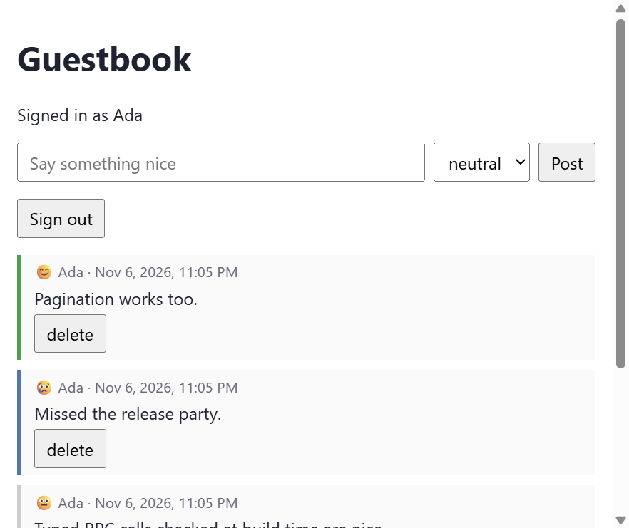

# Guestbook example

A signed-in guestbook in vanilla DOM (no React). Visitors pick a display name to get a session
token, post short messages with a mood, page through older entries and delete their own posts.
A moderator key unlocks a "clear everything" function.

It covers the server-side features the todo example does not: **authentication, authorization
guards, typed application errors, enums, nullable values and cursor pagination**. On the
frontend it shows **a hand-written inline alias file**, **a build-time macro**, **local structs**
and **narrowing an enum with `the`**.



## Run it

```sh
npm install                  # once, at the repository root
npm run serve:guestbook      # terminal 1: build + tsc + JSON-RPC server on :8080
npm run dev:guestbook        # terminal 2: Vite on http://localhost:5173 (proxies /rpc)
```

To try the moderator-only function, start the backend with a key:

```sh
GUESTBOOK_MODERATOR_KEY=let-me-in npm run serve:guestbook                     # bash/zsh
$env:GUESTBOOK_MODERATOR_KEY = "let-me-in"; npm run serve:guestbook          # PowerShell
```

## Files

| File | What it is |
|---|---|
| `api.server.lisp` | backend: two structs, the authenticator, seven server functions |
| `browser-aliases.client.lisp` | inline shorthands for the DOM and `localStorage`; compiles to an empty module |
| `session.client.lisp` | stores the token and sends it as `Authorization: Bearer ...` on every call |
| `view.client.lisp` | renders one entry as an `<li>` using the server's `GuestEntry` type |
| `main.client.lisp` | entry point: page state, error handling, event wiring |
| `index.html`, `vite.config.js` | the page (element ids the code looks up) and the dev server proxy |

## How it works

### Sessions and the authenticator

`sign-in` validates the name, creates a random 64-character token (`random-token 32`) and stores
`token → name` in a hash table. The frontend keeps the token in `localStorage` and configures
the generated runtime once:

```lisp
(configureRpc '{}(:headers (lambda ()
                             (declare (returns (record string string)))
                             (let ((:const token (current-token)))
                               (if token '{}(:Authorization (concat "Bearer " token)) '{})))))
```

The headers function runs before every request, so signing in or out needs no
reconfiguration. On the server, `*authenticator*` turns that header back into a principal once
per request:

```lisp
(setf *authenticator*
      (lambda (context)
        (let ((token (bearer-token context)))
          (and token (= (length token) 64) (gethash token *guest-sessions*)))))
```

Whatever it returns is `(context-principal *request-context*)` inside server functions, here the
display name. `whoami` simply returns it (`null` for anonymous callers), which is how the page
restores a session after a reload.

### Guards

| Function | Guard | Meaning |
|---|---|---|
| `sign-in`, `whoami`, `list-entries` | none (`:public`) | anyone |
| `post-entry`, `delete-entry`, `sign-out` | `:auth :authenticated` | the authenticator returned a principal |
| `clear-guestbook` | `:auth moderator-p` | a predicate: `X-Moderator-Key` must equal the env var (compared with `constant-time-equal`; no env var means nobody passes) |

A failed guard is error `-32001`, before any of the function's code runs.

### Typed errors

Application errors use `rpc-fail` with codes from the server-reserved range. The frontend
switches on `RpcError.code`, so these codes are part of the API contract, just like the schemas:

| Code | Raised by | Message |
|---|---|---|
| -32010 | `sign-in` | name contains characters other than letters, digits, space, `_`, `-` |
| -32011 | `post-entry` | message is empty after trimming |
| -32012 | `post-entry` | duplicate post; `RpcError.data` carries the existing entry's id |
| -32013 | `delete-entry` | not your entry |
| -32001 | any guarded function | not signed in (the page resets to the sign-in form) |
| -32602 | any | input failed schema validation (e.g. a 300-character message) |

`main.client.lisp` wraps every handler in a `reporting-errors` macro, which expands at build time
into a `try/catch` that shows `explain(e)` for `RpcError`s and a generic message otherwise.

### Enums and pagination

`(mood (member "happy" "neutral" "sad"))` becomes `mood: "happy" | "neutral" | "sad"` in the
generated `GuestEntry` interface. The server rejects any other value, and so does the build:
`(post-entry "hi" "angry")` fails with *argument mood of server function post-entry must be
"happy" | "neutral" | "sad"*. A `<select>`'s value is just a `string`, so the frontend narrows it
explicitly:

```lisp
(post-entry (input-value "message") (the (member "happy" "neutral" "sad") (input-value "mood")))
```

`list-entries` returns `(object (entries (array guest-entry)) (next-cursor (nullable fixnum)))`.
That is `{ entries: GuestEntry[]; nextCursor: number | null }` in TypeScript, built on the server as
a property list. Pass `nextCursor` back as `beforeId` to get the next page; `null` means there is
no more.

### The alias file

`browser-aliases.client.lisp` is a small [inline alias file](../../docs/inline-aliases.md).
Every alias is pasted into the caller at build time:

```lisp
(export (defun input-el (id) (the |HTMLInputElement| (document.getElementById id))))
(export (defun input-value (id) (.. (input-el id) value)))
```
```ts
// in build/main.ts, where main.client.lisp says (input-value "name"):
(document.getElementById("name") as HTMLInputElement).value
```

The module itself compiles to `export {};`, and nothing imports it at runtime.

## Try it with curl

```sh
curl -s localhost:8080/rpc -H 'Content-Type: application/json' \
  -d '{"jsonrpc":"2.0","method":"sign-in","params":["Ada"],"id":1}'
# {"jsonrpc":"2.0","result":{"token":"…64 hex chars…","name":"Ada"},"id":1}

curl -s localhost:8080/rpc -H 'Content-Type: application/json' -H "Authorization: Bearer $TOKEN" \
  -d '{"jsonrpc":"2.0","method":"post-entry","params":{"message":"hi","mood":"happy"},"id":2}'

curl -s localhost:8080/rpc -H 'Content-Type: application/json' \
  -d '{"jsonrpc":"2.0","method":"post-entry","params":["hi"],"id":3}'
# {"jsonrpc":"2.0","error":{"code":-32001,"message":"Unauthorized"},"id":3}

curl -s localhost:8080/rpc -H 'Content-Type: application/json' -H 'X-Moderator-Key: let-me-in' \
  -d '{"jsonrpc":"2.0","method":"clear-guestbook","params":[],"id":4}'
```

Params can be positional (an array) or named (an object with camelCase keys). In PowerShell,
use `curl.exe` and put the JSON in a variable to avoid quoting trouble.

## Tests

`tests/example-tests.lisp` (`guestbook-backend`) exercises these behaviours: sign-in validation,
the auth error codes, the enum, duplicate detection with `:data`, pagination, ownership checks and
sign-out. Run them with `npm test -- --suite examples`.
