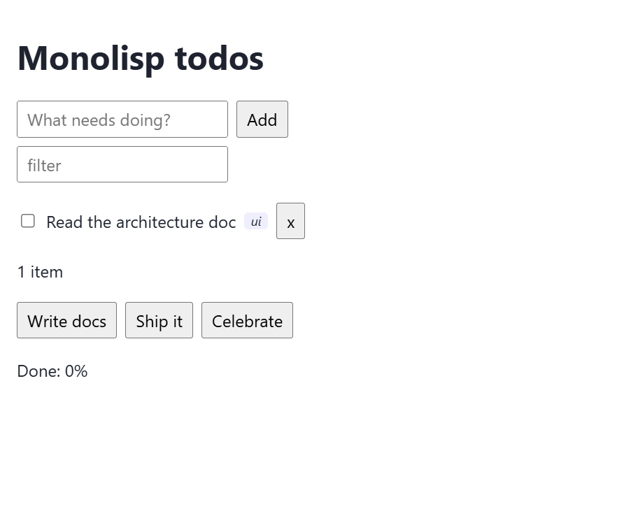

# Todo example

The starter example: a React todo list backed by seven server functions. Read this one first. The
[guestbook](../guestbook/README.md) adds auth and error handling, and the
[dashboard](../dashboard/README.md) adds async server work and library alias files.



## Run it

```sh
npm install              # once, at the repository root
npm run serve:example    # terminal 1: build + tsc + JSON-RPC server on :8080
npm run dev:example      # terminal 2: Vite on http://localhost:5175 (proxies /rpc)
```

## Files

| File | What it shows |
|---|---|
| `api.server.lisp` | `define-rpc-struct todo` with an optional bounded array field; CRUD server functions; a nullable result (`toggle-todo`); an object result (`stats`); an async function with a timeout (`slow-search`); an `:auth :authenticated` guard (`admin-reset`) |
| `utils.client.lisp` | a plain ES module: an exported `defstruct`, typed functions, `loop` (`collect`, `maximize ... into`, `finally`), hash tables, `handler-case`, multiple values, struct inheritance |
| `app.clientx.lisp` | React: `useState` via `:multi` `let`, `useEffect` / `useCallback`, JSX with `map`, typed server calls (`add-todo title (vector "ui")` is checked against the backend schema) |
| `main.clientx.lisp` | entry point: `createRoot(...).render(<App />)` |

## How the pieces connect

1. `api.server.lisp` registers the functions when the build script loads it.
2. The transpiler compiles `utils`, then `app` (it imports `utils`), then `main`. Each call to
   a server function such as `(list-todos)` becomes `listTodos()`, plus an import from the
   generated `./server-functions`.
3. `build/server-functions.ts` declares `interface Todo { id: number; title: string; done:
   boolean; tags?: string[] }` and `addTodo(title: string, tags?: string[]): Promise<Todo>`.
   `tsc --strict` checks the components against it.
4. In the browser, `addTodo("x", ["ui"])` POSTs `{"jsonrpc":"2.0","method":"add-todo","params":["x",["ui"]],"id":1}`
   to `/rpc`. The server validates the title (string, max 200) and tags (at most 16 strings of
   at most 32 characters), runs the Lisp function and encodes the `todo` struct back as JSON.
